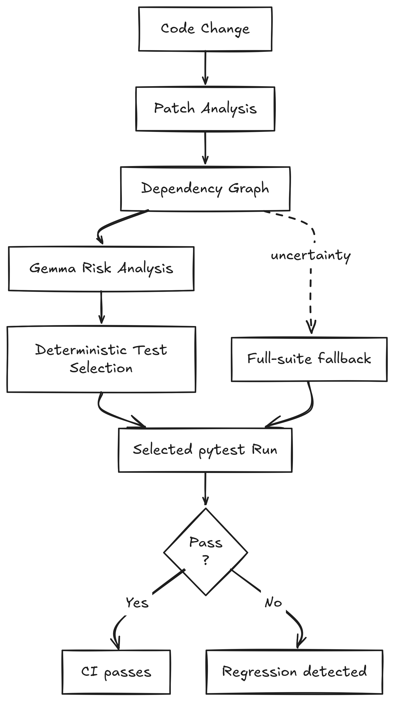

# 💣 BlastRadius

An AI-assisted **regression test selection** tool for Python repositories.

BlastRadius compares two Git revisions, combines dependency evidence with
Gemma's semantic impact analysis, selects tests deterministically, and
executes the selected tests.

> Given this change, which tests should run first to catch a regression?

Gemma reads the patch, changed code, dependency context, and existing test
catalog, then infers behavioral risks and maps them to tests that may regress.
BlastRadius uses those relationships to select and run the relevant tests.

## But how does it evaluate with real code?

The controlled banking benchmark was run five times per scenario with Gemma 4 26B,
pytest, and the benchmark's own Python environment:

| Scenario | Avg selected tests | Avg selected time | Avg full time | Avg reduction | Detected |
|---|---:|---:|---:|---:|---:|
| A — boundary | 10.8 / 22 | 0.237s | 0.510s | 53.3% | 5 / 5 |
| B — fee exemption | 13.0 / 22 | 0.233s | 0.507s | 53.7% | 5 / 5 |
| C — transaction state | 8.4 / 22 | 0.298s | 0.540s | 45.7% | 5 / 5 |

These results are controlled research evidence, not a guarantee of complete
regression detection. The full machine-readable runs are in the
[banking-benchmark-blastradius repository](https://gitlab.com/watetaks/banking-benchmark-blastradius).

## How it works

<p align="center">
  
</p>

## Gemma as a semantic impact engine

File names and direct dependency edges are not enough for regression selection. For example,
A one-character change in a balance condition can affect behavior across
several modules without producing an obvious test dependency.

Gemma can identify that a changed `Account.withdraw` boundary matters to an
exact-balance payment test even when the test lives in another module. This
risk-to-test mapping directly drives which tests BlastRadius considers relevant.

BlastRadius deliberately keeps safety-critical behavior outside the model,
for example, AST analysis for building dependency evidence, validation of model
output, and conservative full-suite fallback in case of unknown dependencies.

This makes the model useful without making it the source of truth for what
gets executed.

## What can fail

The model may miss a relevant test, vary between runs, or describe a risk too
broadly. Static discovery can miss dynamic dispatch, framework-generated
routes, and unusual Python patterns. In those cases BlastRadius may select
too many tests or fall back to the full suite.

## Try the benchmark

The most reproducible demo uses the companion benchmark repository:

```bash
git clone https://gitlab.com/watetaks/blastradius.git
git clone https://gitlab.com/watetaks/banking-benchmark-blastradius.git

cd blastradius
uv sync

cd ../banking-benchmark-blastradius
uv sync --all-groups
cp ../blastradius/.env.example .env
git switch eval/scenario-a
export BLASTRADIUS_PYTHON="$PWD/.venv/bin/python"
BASE=2f68767
TARGET=021924b
PYTHONPATH=../blastradius/src \
  ../blastradius/.venv/bin/blastradius run \
  --repo . --base "$BASE" --target "$TARGET" \
  --python "$BLASTRADIUS_PYTHON" --compare
```

This is a Scenario A output from the benchmark repository:

```text
Changed: 1 files (+1/-1)
Graph: 78 nodes, 90 edges
Risks: 1
Selected: 10/22 tests
    tests/test_account.py::test_withdraw_reduces_balance
    tests/test_payment.py::test_exempt_payment_only_moves_amount
    tests/test_payment.py::test_payment_moves_amount_and_fee
    tests/test_payment.py::test_payment_rejects_amount_plus_fee_over_balance
    tests/test_payment.py::test_payment_rejects_non_positive_amount
    tests/test_transactions.py::test_completed_transaction_can_be_refunded
    tests/test_transactions.py::test_completed_transaction_cannot_be_cancelled
    tests/test_transactions.py::test_exempt_transaction_has_zero_fee
    tests/test_transactions.py::test_transaction_cannot_process_twice
    tests/test_transactions.py::test_transaction_processes_payment
Full-suite fallback: False
Selected run: FAIL
```

The exact selected count can vary between runs because Gemma is probabilistic;
the result above is one recorded run. The benchmark's five-run averages are
reported above.

Use the scenario branches listed in the benchmark README to reproduce A, B,
or C. For CI, install BlastRadius as a CLI and use the same command with the
merge-base of the pull request.

## Setup

From the BlastRadius repository:

```bash
uv sync
uv run blastradius --help
```

Install as a local command:

```bash
uv tool install --editable /absolute/path/to/blastradius
blastradius --help
```

When analyzing another repository, install its dependencies and point
BlastRadius at that repository's Python environment:

```bash
cd /absolute/path/to/benchmark
uv sync --all-groups
export BLASTRADIUS_PYTHON="$PWD/.venv/bin/python"
```

## Configuration

BlastRadius requires an AI model. The model can run locally or through a
hosted provider such as Ollama, OpenRouter, DigitalOcean, or another service
that exposes the required chat API.

Environment variables:

```bash
export BLASTRADIUS_BASE_URL="http://localhost:11434/v1"
export BLASTRADIUS_MODEL="gemma-local"
export BLASTRADIUS_API_KEY=""
```

Place these values in the target repository's `.env`, the repository being
analyzed, not the BlastRadius repository. The file is loaded automatically and
must not be committed. Copy the example first:

```bash
cp /absolute/path/to/blastradius/.env.example .env
```

Hosted provider example:

```bash
export BLASTRADIUS_BASE_URL="https://openrouter.ai/api/v1"
export BLASTRADIUS_MODEL="google/gemma-3-27b-it"
export BLASTRADIUS_API_KEY="your-key"
```

## Analyze a commit or pull request

The target must have the desired target revision checked out. The base and
target must be real Git revisions, not placeholder names.

For one commit:

```bash
BASE=$(git rev-parse HEAD^)
TARGET=$(git rev-parse HEAD)

blastradius run \
  --repo . \
  --base "$BASE" \
  --target "$TARGET"
```

For a local PR branch:

```bash
BASE=$(git merge-base main HEAD)

blastradius run \
  --repo . \
  --base "$BASE" \
  --target HEAD
```

Analysis only, without pytest execution:

```bash
blastradius run \
  --repo . \
  --base "$BASE" \
  --target HEAD \
  --no-run
```

The command reports changed files, graph size, model risks, selected tests,
and selected-suite results. Add `--compare` for full-suite results and timing
comparison:

```bash
blastradius run \
  --repo . \
  --base "$BASE" \
  --target HEAD \
  --compare
```

The companion benchmark is a separate repository with 22 tests, a FastAPI
transaction surface, and optional test-cost simulation:

```bash
BENCHMARK_TEST_DELAY=0.05 uv run pytest
```

The delay is useful for measuring selection savings. Keep it disabled for
normal development.

## Test patches and evaluation

For a normal PR, no test-patch step is needed. Existing target tests form the
catalog, even when the PR does not modify them.

For controlled evaluation, keep application and test changes separate:

```text
baseline commit
  └── application patch commit
        └── test patch commit
```

Analyze the application commit while making the test patch available only in
the working tree:

```bash
git checkout APPLICATION_COMMIT
git restore --source TEST_COMMIT --worktree -- tests

blastradius run \
  --repo . \
  --base BASE_COMMIT \
  --target APPLICATION_COMMIT
```

This prevents newly added answer-key tests from influencing model selection,
while still allowing them to run during evaluation.

The `evaluation/` directory contains controlled patch fixtures and a manifest.
Those files document expected detection results; BlastRadius does not consume
the answer key during normal selection.

## CI routing usage

CI can use BlastRadius as a test router: run likely affected tests first. Add
`--compare` when CI also needs full-suite comparison or confidence reporting.

Generic CI sequence:

```bash
git checkout "$CI_COMMIT_SHA"
BASE=$(git merge-base origin/main HEAD)

blastradius run \
  --repo . \
  --base "$BASE" \
  --target HEAD
```

Provider credentials belong in CI secrets:

```text
BLASTRADIUS_BASE_URL
BLASTRADIUS_MODEL
BLASTRADIUS_API_KEY
```

No BlastRadius server deployment is required. Install it as a CI tool, then
run it inside the checked-out target repository.

Example GitHub Actions workflow for a target repository:

```yaml
name: BlastRadius

on: pull_request

permissions:
  contents: read

jobs:
  regression-selection:
    runs-on: ubuntu-latest
    steps:
      - uses: actions/checkout@v4
        with:
          fetch-depth: 0
      - uses: astral-sh/setup-uv@v6
      - run: uv tool install "git+https://gitlab.com/watetaks/blastradius.git"
      - run: uv sync
      - name: Run BlastRadius
        env:
          BLASTRADIUS_BASE_URL: ${{ secrets.BLASTRADIUS_BASE_URL }}
          BLASTRADIUS_MODEL: ${{ secrets.BLASTRADIUS_MODEL }}
          BLASTRADIUS_API_KEY: ${{ secrets.BLASTRADIUS_API_KEY }}
        run: |
          base=$(git merge-base origin/main HEAD)
          blastradius run \
            --repo . \
            --base "$base" \
            --target HEAD \
            --python .venv/bin/python \
            --format json \
            --record blastradius-result.json
```

The workflow belongs in the target repository. It is documentation here, not
an executable workflow for BlastRadius itself.

## Relevant problems

These are known follow-up improvements, not current correctness blockers:

- Some less common built-ins or dynamic calls may still be treated as unknown
  dependency edges, triggering the conservative full-suite fallback.
- Model recommendations are provider-dependent. Repeated runs can select
  different valid subsets unless the provider is configured deterministically.
- Dynamic dispatch and framework-generated routes remain only partially
  represented in the dependency graph.
